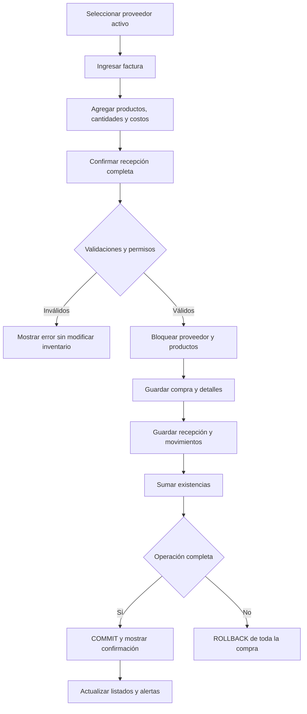
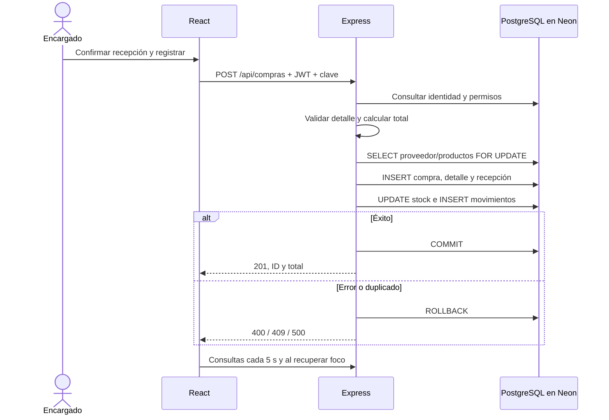
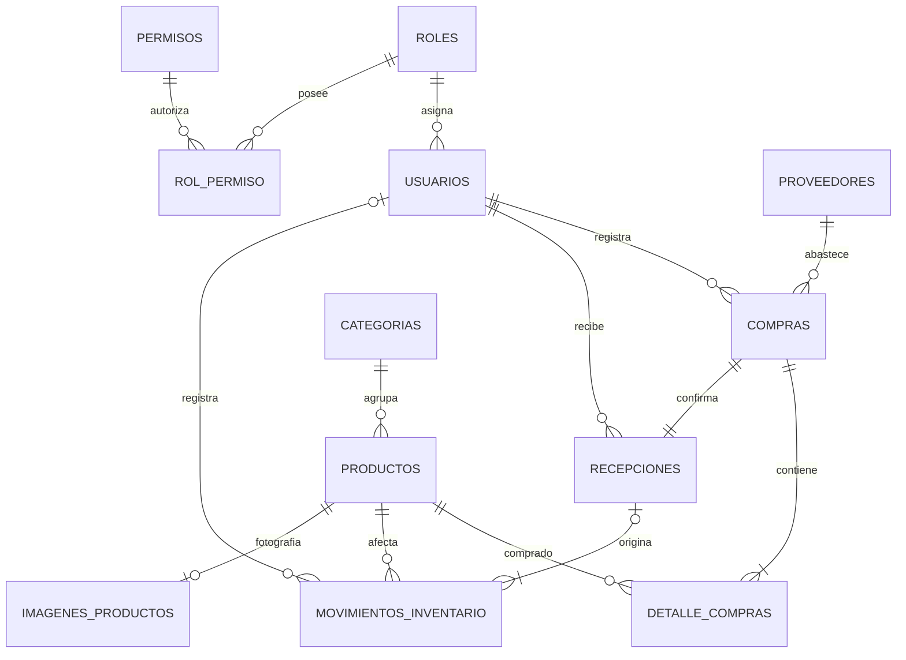
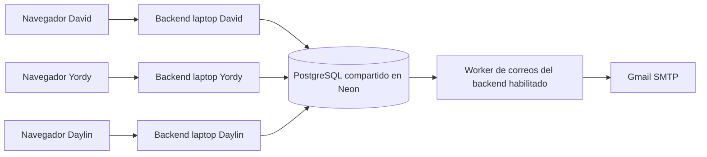

# Diagramas y modelo de datos

## Flujo de negocio

## Secuencia de compra

## Modelo entidad-relación

La recepción es obligatoria en el flujo de la aplicación y se crea en la misma transacción. La FK y el índice SQL garantizan como máximo una por compra. Un movimiento APERTURA puede no tener recepción o usuario. `CORREOS_PENDIENTES` guarda una copia de la dirección destinataria para conservar el destino del evento, sin FK a usuarios. `CLIENTES` permanece independiente del proceso de abastecimiento.

## Diccionario del incremento

| Tabla | Campos principales | Relaciones y restricciones |
|---|---|---|
| PROVEEDORES | ID_PROVEEDOR, NOMBRE, NIT, CORREO, TELEFONO, DIRECCION, ESTADO | PK identity; NIT único; estado A/I |
| COMPRAS | ID_COMPRA, ID_PROVEEDOR, ID_USUARIO, FACTURA, CLAVE, TOTAL, ESTADO, FECHA | Proveedor/usuario FK; factura única por proveedor; clave única; estado RECIBIDA |
| DETALLE_COMPRAS | ID_DETALLE, ID_COMPRA, ID_PRODUCTO, CANTIDAD, COSTO | FKs compra/producto; producto único por compra |
| RECEPCIONES | ID_RECEPCION, ID_COMPRA, ID_USUARIO, FECHA | Compra única y FKs compra/usuario |
| MOVIMIENTOS_INVENTARIO | ID_MOVIMIENTO, ID_PRODUCTO, ID_RECEPCION, ID_USUARIO, TIPO, CANTIDAD, STOCK_ANTERIOR, STOCK_NUEVO, FECHA | Nuevo = anterior + cantidad; tipos APERTURA/ENTRADA_COMPRA; único recepción/producto |
| IMAGENES_PRODUCTOS | ID_PRODUCTO PK/FK, CONTENIDO TEXT, ACTUALIZADO_EN TIMESTAMP | Cero o una imagen WebP por producto; eliminación en cascada |
| PRODUCTOS (ampliación) | STOCK_MINIMO BIGINT DEFAULT 0 | ≥ 0; STOCK existente sigue siendo saldo actual |
| USUARIOS (ampliación) | CORREO VARCHAR(120) | Índice único LOWER(TRIM(CORREO)); permite nulos históricos |
| CLIENTES (ampliación) | Índice sobre CORREO existente | Único LOWER(TRIM(CORREO)) |
| CORREOS_PENDIENTES | ID_CORREO, DESTINATARIO, ASUNTO, MENSAJE, ESTADO, INTENTOS, CREADO_EN, ENVIADO_EN, ULTIMO_ERROR | Estados PENDIENTE/ENVIADO; no guarda contraseñas SMTP |
| MIGRACIONES | NOMBRE, APLICADO_EN | Evita reaplicar el incremento |

El SQL con tipos completos está en `database/003_postgres.sql` (motor activo); `database/002_sprint2.sql` conserva el incremento histórico Oracle. Los saldos no se duplican en otra tabla INVENTARIO: el inventario se consulta desde PRODUCTOS y su historial se conserva en MOVIMIENTOS_INVENTARIO.

## Arquitectura compartida

Cada equipo usa la misma base y rama de Neon. Las pantallas consultan cambios cada cinco segundos; Neon no aloja el backend. El envío necesita al menos un backend encendido con SMTP habilitado. Los workers coordinan la cola con FOR UPDATE SKIP LOCKED.
